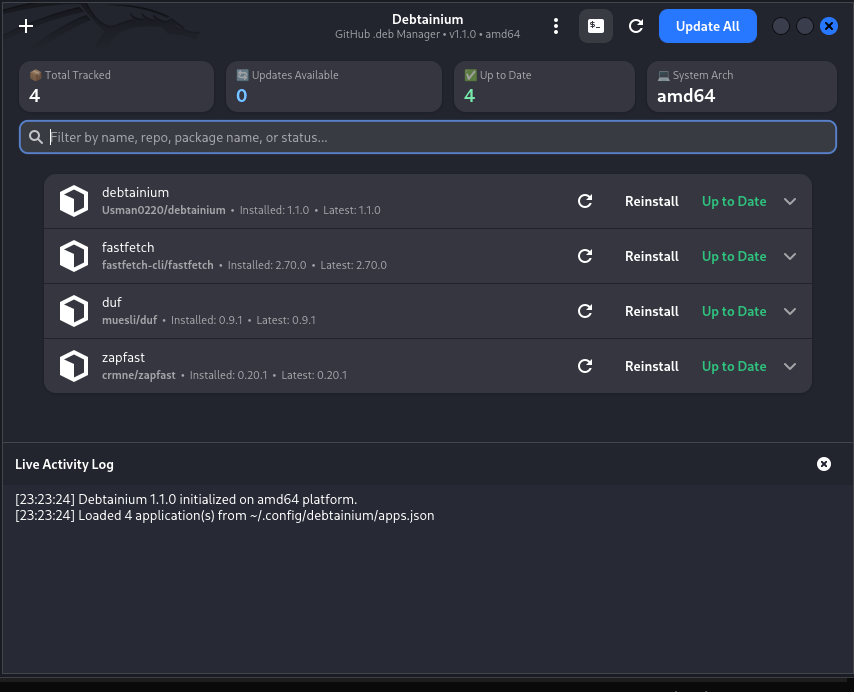
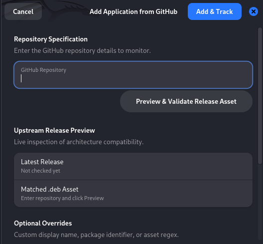

# Debtainium

**Debtainium** is an Obtainium-style desktop and CLI utility for Debian and Ubuntu. It tracks third-party software distributed as Debian packages (`.deb`) on GitHub Releases, picks out the asset that matches your architecture, verifies its SHA-256 digest, and installs or updates it through `pkexec` and `apt`.

<p align="center">
  
</p>

## Install

One command. It finds the newest release, downloads the `.deb`, checks it against
the published SHA-256, and installs it with `apt`:

```bash
curl -fsSL https://raw.githubusercontent.com/Usman0220/debtainium/main/install.sh | sudo bash
```

Needs Debian 12+, Ubuntu 22.10+ or any derivative that ships GTK4 and libadwaita; `apt` pulls in the rest. Nothing is added to your apt sources.

Then, to check for updates every six hours in the background (run this as yourself, not with `sudo`):

```bash
systemctl --user enable --now debtainium-notify.timer
```

<details>
<summary>Prefer not to pipe a script into a shell?</summary>

[Read `install.sh`](install.sh) first — it is about 130 lines of plain bash with no hidden steps. Or install by hand:

1. Open the [latest release](https://github.com/Usman0220/debtainium/releases/latest).
2. Download `debtainium_*_all.deb` and its `.sha256` file.
3. Verify and install:

   ```bash
   sha256sum -c debtainium_*_all.deb.sha256
   sudo apt install -y ./debtainium_*_all.deb
   ```

The installer accepts `--tag v1.1.1` to pin a release, `--enable-timer` to turn the background checker on, and `--dry-run` to download and verify without installing.

</details>

## Adding software

Click **+**, paste a GitHub repository (`owner/repo` or the full URL), and optionally preview the release asset before tracking it. The same works from the CLI with `debtainium add owner/repo`.

<p align="center">
  
</p>

## Features

- **Standard-library networking** — Python 3.10+ `urllib` only, no pip dependencies, no bundled HTTP stack.
- **GTK4 / Libadwaita interface** — expandable rows, toast notifications, a live activity log, an in-app release-notes viewer, and a status-aware search filter.
- **Complete CLI** — `add`, `remove`, `list`, `check`, `update`, `auto`, `export`, `import`, `notify`, `gui`, plus `--json` and `--version`.
- **Smart asset detection** — picks `.deb` assets matching `amd64`, `arm64`, `armhf` or `all`, with an optional per-app regex filter.
- **Update All** — one button, or `debtainium update --all`; it checks everything first, then installs each available update and reports per-app failures instead of stopping at the first one.
- **Automatic installation policy** — flag apps with `debtainium auto <app> on` or the switch in each row, then `debtainium update --auto` (or a systemd timer) installs only those.
- **Portable import / export** — move the tracked list between machines as JSON; imports merge by repository, so repeating one is harmless.
- **Rate-limit aware** — reads `GITHUB_TOKEN`, `GH_TOKEN`, or a token file at `~/.config/debtainium/token`.
- **dpkg-accurate version comparison** — compares installed versions using `dpkg --compare-versions`, not string sorting.
- **Integrity checks** — verifies SHA-256 digests from companion files or release metadata before installation.
- **Safe privilege escalation** — installs with `pkexec apt-get install -y <absolute path>.deb`, so dependencies resolve and the app itself never runs as root.
- **Config safety** — atomic saves, `apps.json.bak` kept on every write, and an unparseable config preserved as `apps.json.corrupt-<timestamp>` instead of being replaced with an empty list.
- **Self-updating** — Debtainium tracks its own repository.

## Usage

### Graphical interface

Launch it from your application menu, or run `debtainium gui`. The header holds **Update All**, a refresh-everything button, and a menu for import/export, timers and About. Every row expands to show its repository, package identifier, version status, asset filter, an auto-update switch and the release notes.

### Command line

```bash
# List tracked applications (--json for scripting)
debtainium list

# Track a repository; --auto flags it for unattended installation
debtainium add fastfetch-cli/fastfetch
debtainium add muesli/duf --auto

# Turn the automatic policy on or off
debtainium auto duf off

# Check everything, then install a single app or all available updates
debtainium check
debtainium update fastfetch
debtainium update --all
debtainium update --auto

# Back up and restore the list
debtainium export -f ~/debtainium-apps.json
debtainium import ~/debtainium-apps.json            # merge
debtainium import ~/debtainium-apps.json --replace  # overwrite

# Notify about available updates (what the systemd timer runs)
debtainium notify
```

### Background checks and unattended installs

| Timer | What it does |
|---|---|
| `debtainium-notify.timer` | Checks every 6 hours and sends a desktop notification. No privileges needed. |
| `debtainium-autoupdate.timer` | Runs `debtainium update --auto` daily, installing the apps you flagged. |

The second one is **not enabled by default**: unattended installation needs a polkit rule, because `pkexec` would otherwise wait for a password nobody can type. An example rule ships in `/usr/share/doc/debtainium/examples/49-debtainium-autoupdate.rules`. Read it before installing it — membership in the group it creates is effectively passwordless root for package management.

### Private repositories and rate limits

Anonymous GitHub API requests are limited to 60 per hour. Provide a token through the environment or a file:

```bash
# environment
export GITHUB_TOKEN=ghp_...

# or a file, which is what the systemd timers will see
install -m 600 /dev/null ~/.config/debtainium/token
printf '%s\n' 'ghp_...' > ~/.config/debtainium/token
```

Debtainium warns if that file is readable by other users.

### Configuration

| Path | Purpose |
|---|---|
| `~/.config/debtainium/apps.json` | tracked applications |
| `~/.config/debtainium/apps.json.bak` | previous version of that file |
| `~/.config/debtainium/token` | optional GitHub token |
| `~/.cache/debtainium/` | downloaded `.deb` packages |

`XDG_CONFIG_HOME` and `XDG_CACHE_HOME` are respected.

## Build from source

```bash
git clone https://github.com/Usman0220/debtainium.git
cd debtainium
./build-deb.sh
```

The script normalises file permissions, validates the AppStream metadata and desktop entry when those tools are installed, builds `debtainium_<version>_all.deb`, and runs `lintian`.

## License

MIT — see [copyright](debtainium/usr/share/doc/debtainium/copyright).
